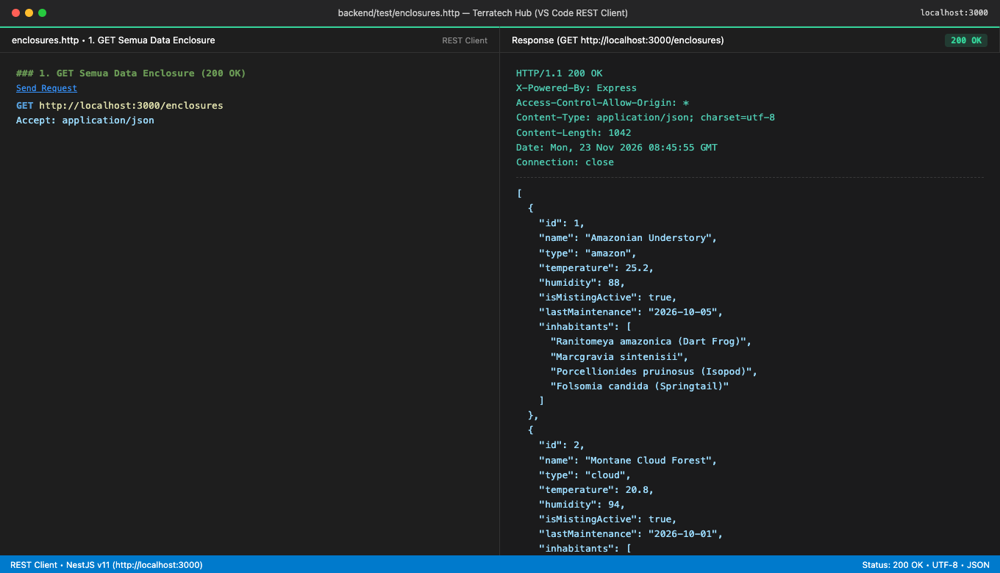
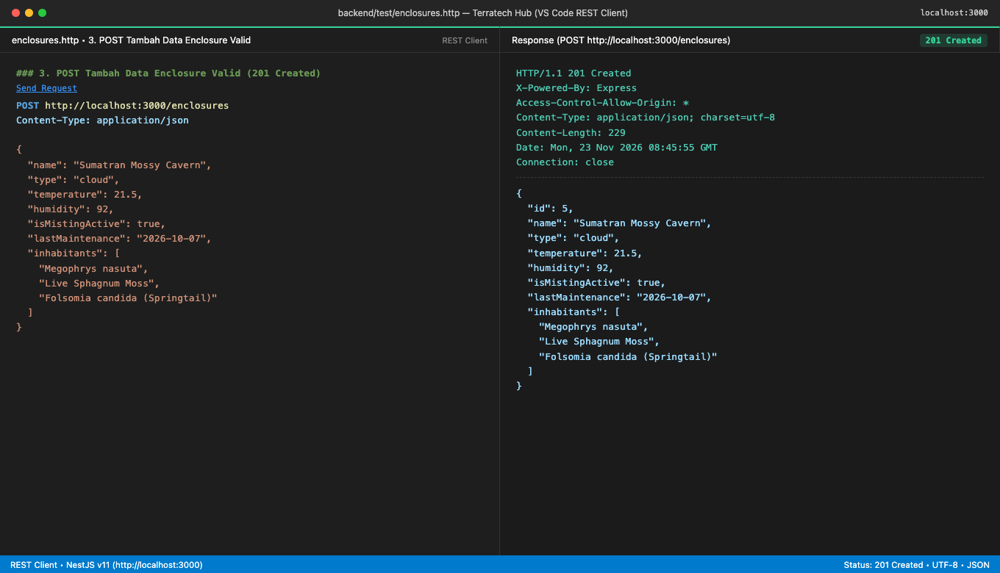
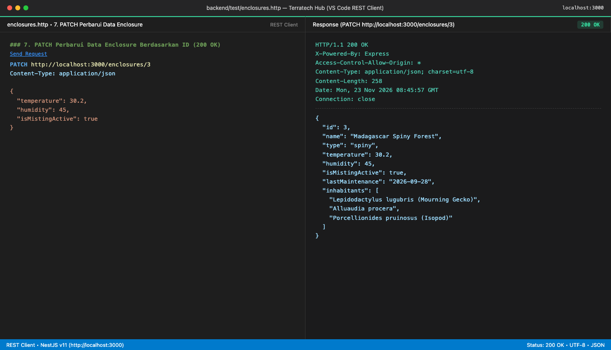
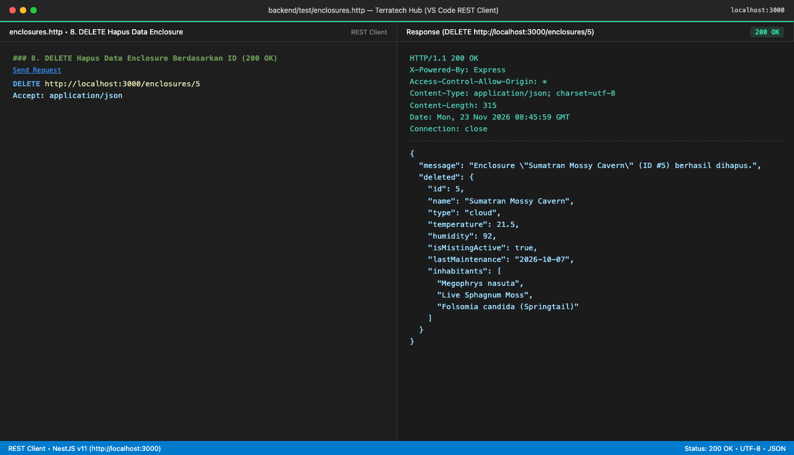
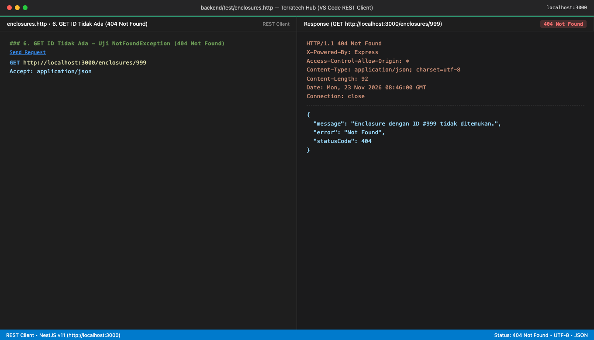
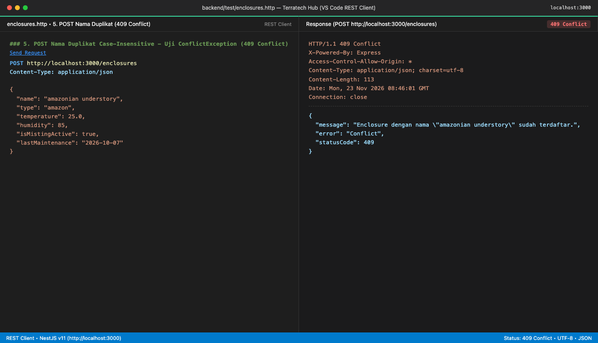
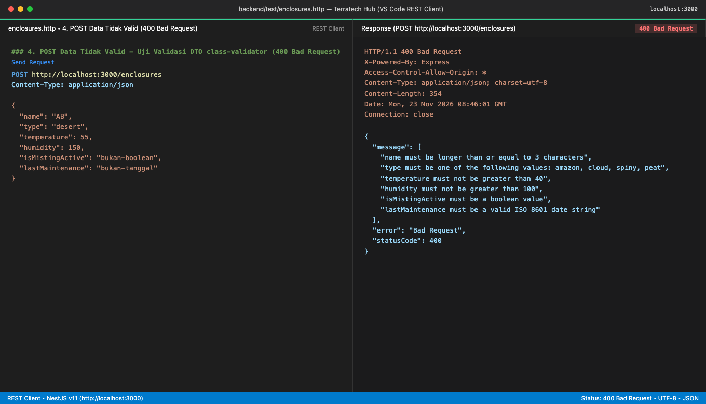
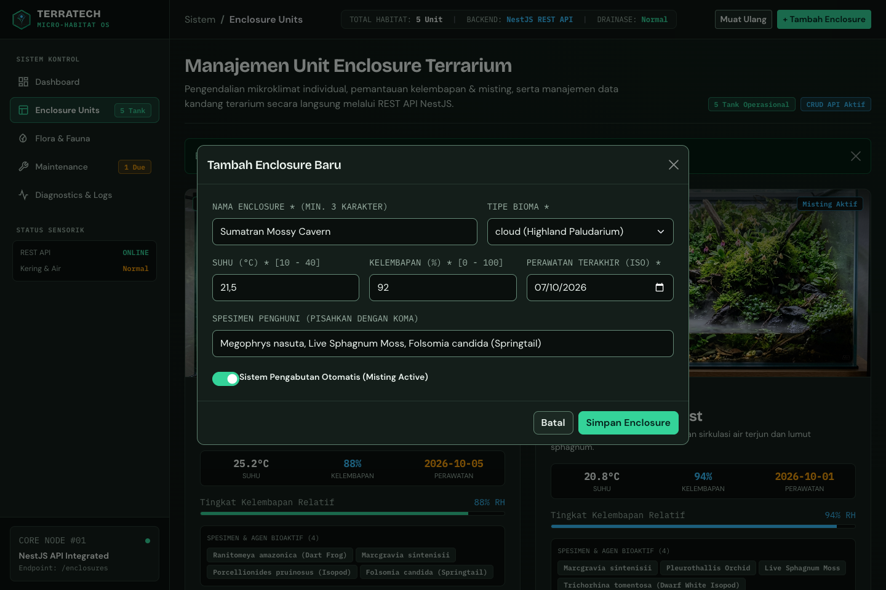
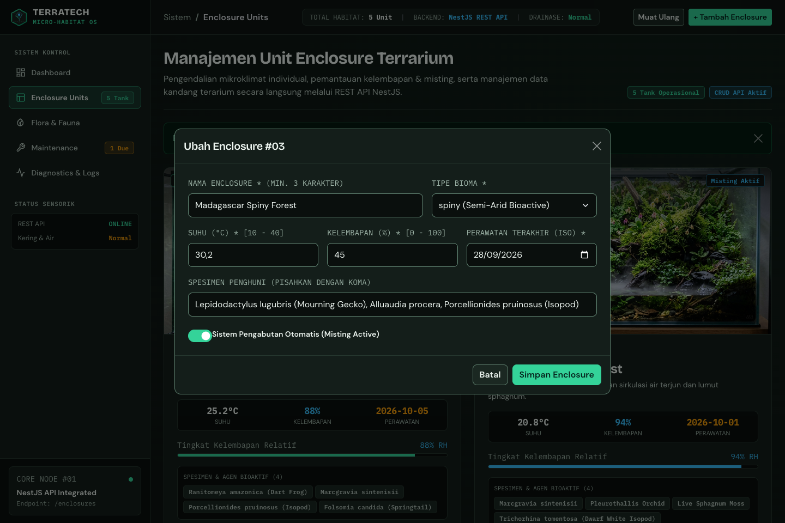
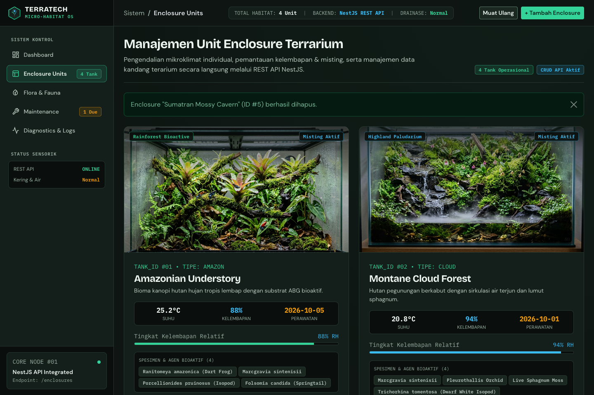

# Terratech Hub - Micro-Habitat & Terrarium Automation System

Terratech Hub adalah sistem pemantauan dan manajemen perawatan terarium/vivarium bioaktif berbasis web. Proyek ini memadukan **Frontend HTML5 + Bootstrap 5.3** (tema *Biophilic Precision Instrument*) dengan **Backend REST API NestJS (Struktur MVC / Modular)** untuk pengelolaan data **Enclosure** (unit kandang/tangki habitat).

---

## Gambaran Umum Proyek

Aplikasi ini dirancang untuk memantau mikro-ekosistem tertutup (vivarium hutan hujan, paludarium pegunungan, terarium semi-arid, dan riparium gambut). Sistem menyediakan dashboard telemetri sensorik, manajemen unit enclosure terintegrasi CRUD REST API, katalog flora & fauna bioaktif, jadwal pemeliharaan, serta log diagnostik perangkat keras.

---

## Struktur Direktori Proyek

```text
proyek/
├── frontend/                  # Aplikasi Frontend (HTML5 + Bootstrap 5.3 + Fetch API)
│   ├── assets/
│   │   ├── css/
│   │   │   ├── reset.css
│   │   │   └── style.css      # Custom theme Biophilic Dark Mode & komponen domain
│   │   ├── js/
│   │   │   └── api.js         # Modul Fetch REST API ke http://localhost:3000/enclosures
│   │   └── images/
│   │       ├── enclosures/    # Foto unit terrarium (tank-01 s/d tank-04)
│   │       ├── flora-fauna/   # Foto spesimen hayati & agen bioaktif
│   │       └── icons/         # Ikon SVG sistem
│   ├── index.html             # 1. Dashboard Utama
│   ├── dashboard.html         # Alias Dashboard
│   ├── units.html             # 2. Enclosure Units (Integrasi CRUD API NestJS)
│   ├── registry.html          # 3. Flora & Fauna Registry
│   ├── maintenance.html       # 4. Maintenance Schedule
│   └── diagnostics.html       # 5. Diagnostics & Logs
├── backend/                   # Aplikasi Backend REST API (NestJS + TypeScript)
│   ├── src/
│   │   ├── enclosures/
│   │   │   ├── dto/
│   │   │   │   ├── create-enclosure.dto.ts
│   │   │   │   └── update-enclosure.dto.ts
│   │   │   ├── entities/
│   │   │   │   └── enclosure.entity.ts
│   │   │   ├── enclosures.controller.ts
│   │   │   ├── enclosures.module.ts
│   │   │   └── enclosures.service.ts
│   │   ├── app.module.ts
│   │   └── main.ts
│   └── test/
│       └── enclosures.http    # File uji REST Client VS Code
├── docs/
│   └── screenshots/           # Dokumentasi tangkapan layar pengujian API & UI
├── .gitignore
└── README.md
```

---

## Struktur 5 Menu Frontend

| Menu | File | Deskripsi Fungsional |
| :--- | :--- | :--- |
| **1. Dashboard** | `frontend/index.html` | Ringkasan telemetri sistem: suhu (°C), kelembapan relatif (%), spektrum lampu UV, matriks aktuator, dan log peringatan. |
| **2. Enclosure Units** | `frontend/units.html` | Manajemen unit terrarium individual yang terhubung langsung ke REST API NestJS (`GET`, `POST`, `PATCH`, `DELETE`). |
| **3. Flora & Fauna** | `frontend/registry.html` | Katalog keanekaragaman hayati: taksonomi, parameter mikroklimat ideal, dan penyaringan kategori. |
| **4. Maintenance** | `frontend/maintenance.html` | Kalender agenda pemeliharaan Oktober 2026, checklist tugas interaktif, dan tabel riwayat perawatan. |
| **5. Diagnostics & Logs** | `frontend/diagnostics.html` | Laporan *health check* aktuator, histori log anomali 24 jam, dan formulir inspeksi manual. |

---

## Cara Menjalankan Proyek

### 1. Menjalankan Backend (NestJS)

Pastikan **Node.js** dan **npm** sudah terpasang, lalu jalankan perintah berikut:

```bash
cd backend
npm install
npm run start:dev
```

Server backend akan berjalan di **`http://localhost:3000`** dengan CORS dan `ValidationPipe` global aktif.

Untuk memastikan build produksi bebas dari error TypeScript:

```bash
cd backend
npm run build
```

### 2. Menjalankan Frontend

Buka terminal baru pada root proyek, lalu jalankan server statis pada folder `frontend/`:

```bash
cd frontend
python3 -m http.server 8000
```

Kemudian buka **`http://localhost:8000/units.html`** (atau gunakan ekstensi **Live Server** di VS Code pada file `frontend/units.html`) untuk menguji fitur Tambah, Ubah, Toggle Misting, dan Hapus Enclosure yang terhubung ke backend NestJS.

---

## Daftar Endpoint REST API (`/enclosures`)

Base URL: `http://localhost:3000`

| Method | Endpoint | Deskripsi | Status Sukses | Kemungkinan Error |
| :--- | :--- | :--- | :--- | :--- |
| `GET` | `/enclosures` | Mengambil seluruh daftar enclosure (termasuk 4 data seed awal) | `200 OK` | - |
| `GET` | `/enclosures/:id` | Mengambil detail satu enclosure berdasarkan `id` numerik | `200 OK` | `400 Bad Request` (ID bukan angka), `404 Not Found` |
| `POST` | `/enclosures` | Menambahkan unit enclosure baru dengan validasi DTO | `201 Created` | `400 Bad Request` (Validasi gagal), `409 Conflict` (Nama duplikat) |
| `PATCH` | `/enclosures/:id` | Memperbarui sebagian/seluruh data enclosure berdasarkan `id` | `200 OK` | `400 Bad Request`, `404 Not Found`, `409 Conflict` |
| `DELETE` | `/enclosures/:id` | Menghapus unit enclosure berdasarkan `id` | `200 OK` | `404 Not Found` |

### Contoh Payload `POST /enclosures`

```json
{
  "name": "Sumatran Mossy Cavern",
  "type": "cloud",
  "temperature": 21.5,
  "humidity": 92,
  "isMistingActive": true,
  "lastMaintenance": "2026-10-07",
  "inhabitants": ["Megophrys nasuta", "Live Sphagnum Moss", "Springtail"]
}
```

---

## Screenshot Pengujian

Seluruh tangkapan layar hasil pengujian endpoint REST Client dan integrasi Frontend tersimpan di folder `docs/screenshots/`:

### 1. Pengujian Endpoint Backend (REST Client)

- **GET Semua & Satu Data (`200 OK`)**
  
- **POST Data Valid (`201 Created`)**
  
- **PATCH Update Data (`200 OK`)**
  
- **DELETE Data (`200 OK`)**
  
- **Error 404 Not Found (ID Tidak Ditemukan)**
  
- **Error 409 Conflict (Nama Enclosure Duplikat)**
  
- **Error 400 Bad Request (Validasi DTO `class-validator`)**
  

### 2. Pengujian Integrasi Frontend (`units.html`)

- **Tampilan Daftar & Tambah Data Enclosure (Modal Bootstrap)**
  
- **Tampilan Ubah Data Enclosure**
  
- **Tampilan Hapus Data Enclosure & Konfirmasi**
  
